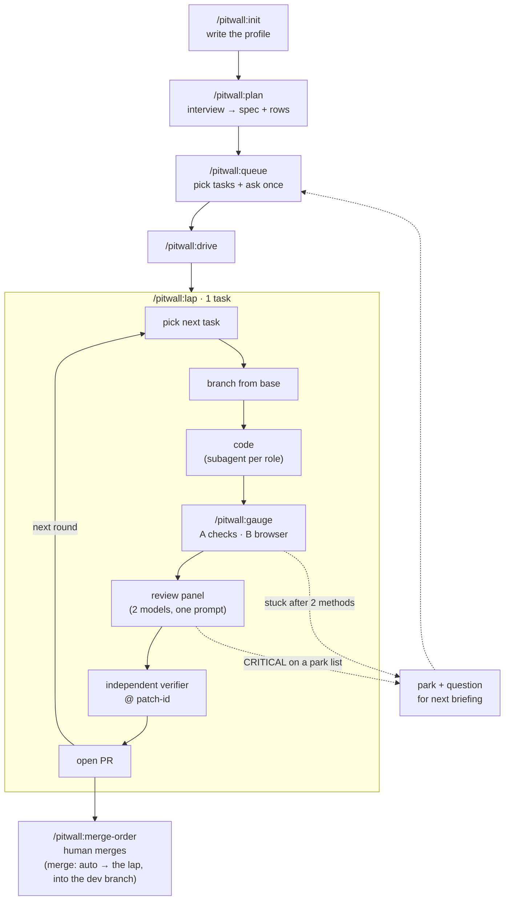

# pitwall

[](https://github.com/aontwit/pitwall/actions/workflows/ci.yml)
[](LICENSE)
[](https://github.com/aontwit/pitwall/stargazers)

The agent loop that queues your work, proves every PR, and leaves the merge to you. Opt in, and it merges into your dev branch itself, only when every gate passes.

Plan in short interview rounds, then ask every remaining question once, up front. Then the agent builds one task per round, proves it, gets a verdict from a verifier that did not write the code, and opens the PR. 18 playbooks, 20 principles. Runs in Claude Code today; Codex, Cursor and Gemini CLI are planned.

> **Quick start:** `/plugin marketplace add aontwit/pitwall`, then `/plugin install pitwall@pitwall`, then run `/pitwall:init` in your repo.

**Who it's for:** developers with a GitHub repo who want a queue of small tasks built and proven while they're away, and who still read every PR and, by default, merge it. A team with a git-flow dev branch can let the loop merge into that branch itself ([Auto merge](#auto-merge)); `main` and release branches stay with a person. It is not an app builder for people who don't review code.

## Your first 30 minutes

1. **Install:** `/plugin marketplace add aontwit/pitwall`, then `/plugin install pitwall@pitwall`.
2. **Init:** `/pitwall:init` in your repo. It reads the repo, asks only what it can't read, and writes `.claude/agent-loop.md` (and `PLAN.md` when you have no plan or tracker).
3. **Commit the profile:** init ends with the exact commands to paste: a direct commit, or a small PR when your base is protected. Merge it before the next step.
4. **Queue one task:** `/pitwall:queue fix the broken sort on the search page`, in your own words. It asks anything it must not guess, once, as tick boxes.
5. **Lap:** `/pitwall:lap` runs one round: branch, code, checks, two-model review, an independent verifier, then a PR.
6. **Review the PR:** read its Verify table and merge it yourself (the default, `merge: human`; under `merge: auto` a later lap merges it into your dev branch once every gate passes). Want more? `/pitwall:plan` for a whole product or a phase, then `/pitwall:drive`. On a new repo it asks the stack in plain words and writes phase 0 (scaffold, checks, a verification skill). On a repo with code but no docs it drafts the spec from the code and asks you to confirm it.

## Why pitwall?

An agent left alone on a queue fails in the same few ways: it asks you something at 2am and waits, it calls a passing typecheck "done", it grades its own work, and it guesses a business rule instead of stopping.

pitwall adds:
- **Questions up front, never mid-round.** `/pitwall:queue` asks everything only a human can decide, once, as tick boxes. The run then follows a 3-step ladder: try it, take a recorded default, or park the task.
- **Evidence, not claims.** `/pitwall:gauge` picks proof by what changed: level A runs your checks, level B drives the page in a browser, level C hands a human numbered steps. Nothing is ticked that was not run.
- **A verdict from someone who did not write the code.** Every PR gets a fresh read-only verifier pinned to its patch-id. A new commit makes the verdict stale.
- **Humans merge.** The agent builds, proves and opens the PR. It never merges (except under [`merge: auto`](#auto-merge), into the dev branch, when every gate passes), force-pushes or pushes to protected branches.
- **One profile per repo.** Everything repo-specific (base branch, check commands, dev server, tracker, plan) lives in `.claude/agent-loop.md`. The plugin holds no repo values.

## How it works



With `parallel` above 1 in the profile, a round runs a batch instead: this session leads up to that many tasks at once, each in its own worktree and branch, one PR per task (not proven yet, see Status).

`/pitwall:stop` ends the loop after the current task. `/pitwall:brake` stops now and saves the work as a WIP commit.

## What's included

### The skill: pitwall

Every command is `/pitwall:<command>`. Or say what you want in plain words, English or Thai, and pitwall picks the playbook:

```
/pitwall:lap
/pitwall:pitwall fix the broken sort on the search page
```

### Commands

| Command | What it does |
|---------|--------------|
| `/pitwall:init` | One-time setup: read the repo, ask what it can't read, write `.claude/agent-loop.md` |
| `/pitwall:doctor` | Check the profile against the contract and say which section is missing |
| `/pitwall:verify-setup` | Write `.claude/skills/verify-<app>/`: a skill that launches, drives and captures evidence from your app (browser for web, a headless scene run plus a frame for Godot), and run it once |
| `/pitwall:plan` | Interview you in rounds of 2–3 questions, record each answer in the spec, and write plan rows (docs-only PR). Modes: `new` (empty repo: stack, `SPEC.md`, phase 0), `survey` (code but no docs: drafts the spec from the code, you confirm), `phase`, `amend` |
| `/pitwall:queue` | Pick tasks the agent can finish alone (6 criteria), then ask every open question once |
| `/pitwall:drive` | Start the loop: one task per round until the queue is empty or you stop it |
| `/pitwall:lap` | Run exactly one round |
| `/pitwall:stop` | Stop after the current task finishes |
| `/pitwall:brake` | Stop now; save unfinished work as a WIP commit |
| `/pitwall:merge-order` | Order your open PRs by stack and readiness, retarget merged parents |
| `/pitwall:secretary` | Read past sessions and report what you keep repeating, as skill / rule candidates |
| `/pitwall:gauge` | Prove the work: Verify table with VERIFIED / PARTIAL / FAIL |
| `/pitwall:ticket` | Create or update the tracker task for a piece of work |

### Playbooks by task type

| Task | Playbook | Its guard |
|------|----------|-----------|
| Bug | `bug-fix` | Reproduce on the real screen before and after the fix |
| Refactor that must not change behaviour | `move-only` | Characterization test locked in the first commit |
| Bring a number down | `ratchet` | The reviewer must say whether the drop is real or a dodged count |
| Bring behaviour over from another branch | `port` | Parity test with golden output from the source |
| New feature | `feature` | Name the data shape before any logic |
| Read-only question | `investigation` | Cited answer, never code |
| Spec and plan rows | `plan` | Every answer lands in a file before the next round |

### Principles

20 ways of thinking adapted from [pstack](https://github.com/cursor/plugins/tree/df581122cde1/pstack), such as `fix-root-causes`, `prove-it-works`, `attack-the-premise` and `never-block-on-the-human`. A playbook cites the principle that changed a decision.

## The profile

`/pitwall:init` writes `.claude/agent-loop.md`. `/pitwall:doctor` checks it. To change a value later (say, PRs in Thai), edit the file, run `/pitwall:doctor` and commit it to your base branch. `/pitwall:init redo` asks everything again.

| Section | Holds |
|---------|-------|
| repo | name, state path, the checkout the loop uses |
| git | base, protected branches, branch / commit / PR patterns, hooks · `merge: human` (default) or `auto` with a `dev branch`: under `auto` the base is the dev branch (git-flow), the loop merges a PR into it only when every gate passes, through one merge script, and `main` / release stay with you |
| checks | level A commands: install, typecheck, lint, test, build |
| level B | dev server, `port: fixed \| free` (tasks take turns on one dev server, or each worktree runs its own), browser, pages, viewports, human-only steps |
| states to build | recipes for the states your tests need |
| repo-specific evidence | file pattern → extra proof + level |
| plan (optional) | where the plan lives and how its rows look |
| tracker (optional) | `clickup`, `github` (GitHub Issues) or `none` (the PR is the record) |
| agents per task | subagent + model per role, review panel, checklists, `parallel: <n>` (missing = 1; above 1 = up to n tasks at once, each in its own worktree, and this session leads them) |
| repo rules | your rules files, principles turned off |
| multi-machine (optional) | hand off loop state between machines |
| permissions | allow / deny for the machine that runs the loop |
| language | language for you, for PRs / commits, for tracker comments |

## Auto merge

Off by default: with `merge: human` (or no `merge` row) you merge every PR. With `merge: auto`, the loop merges its own finished PRs into your dev branch. It is for a team on git-flow: PRs target a dev branch such as `dev`, and a person merges dev into `main` or a release branch. The loop never merges into `main`, `master`, a release or a production branch. Not proven on a live run yet (see Status).

**Turn it on.** `/pitwall:init` asks who merges only when the base is named like a dev branch: `dev`, `development`, or a short form in between such as `devel`. To set it by hand, the profile's `git` section needs `merge: auto` and a `dev branch` row that names the base itself; `/pitwall:doctor` fails anything else (a dev branch that is not the base, looks like `main` / `master` / a release or production line, or is not on origin):

```markdown
| base | `dev` |
| merge | `merge: auto` |
| dev branch | `dev` |
```

**When it merges.** Only in the sync at the start of a `/pitwall:lap` round, never in the middle of a task and never by a lead-mode worker. Only the task PRs the loop opened itself: a plan-sync PR, your own PRs and anyone else's stay with you. One action per round (one merge, or one merge of the dev branch into a PR branch), oldest PR first, from the bottom of each stack; a stacked child is moved onto the dev branch after its parent merges and judged in a later round, once its CI has run there.

**The gates.** A PR merges only when all of them pass:

1. A VERIFIED verdict from a fresh, read-only verifier at the PR's current patch-id. PARTIAL never passes; a PARTIAL PR whose boxes were all ticked since gets one new verifier run first.
2. A "Not done yet" section with nothing left unticked, so no ⏳ and no step waiting for a human.
3. Green CI on the current head and the current base: every check outside the profile's `ignored checks` is green, at least one succeeded, and each one started after the last commit and the last retarget.
4. A fresh dev branch. When the dev branch has commits the PR branch does not hold yet, the loop merges it into the PR branch, pushes, and judges the PR again in a later round, after the new CI. The third time it holds the PR; a conflict outside the files it may resolve itself holds it too.
5. The merge is a merge commit of the judged head (`--match-head-commit`), and the PR must read back as merged into the dev branch.
6. No merge while `/pitwall:stop` or `/pitwall:brake` is set. A PR already merged stays merged.

**Always for a person**, even with every gate passed:

- a PR where the verifier found money, prices or fees, permissions or security, user data, or deletes in the diff (the verifier answers this on every PR; a verdict without that answer gets one new verifier run first)
- a PR that changes CI or the checks: anything under `.github/`, `.githooks/` or `.husky/`, lefthook or pre-commit config, any `package.json`, a `Makefile`, `CODEOWNERS`, ESLint, RuboCop or TypeScript config (`eslint*`, `.eslintrc*`, `.rubocop*`, `tsconfig*`), a path with `baseline` in it, the profile, and the files the profile's check commands run

A held PR gets one line in the round report, `#<n> HOLD <gate>: <reason>` (or the merge script's `REFUSED` / `FAILED` reason as it printed it). A hold that needs you also sends one push notification, in a round you did not start; a hold that ends by itself, such as a check still running, does not. Any other held PR waits for you or for its next commit.

**The permission rule you add.** Every merge goes through one script, `merge-pr.mjs`. It refuses a PR that is a draft, not open, not based on the dev branch or still held by a worker, refuses while stop or brake is set, judges the gates again right before the merge, and runs `gh pr merge <n> --merge --match-head-commit <head>`, never `--admin`, `--auto`, squash or rebase. `gh pr merge` itself stays denied in every repo. Under `merge: auto`, init's report names one rule for this machine's `.claude/settings.local.json` (not the shared `.claude/settings.json`), with the real path of the plugin's `scripts/` folder:

```json
{
  "permissions": {
    "allow": ["Bash(node <absolute pitwall dir>/scripts/merge-pr.mjs:*)"]
  }
}
```

Update the path after a plugin update moves it, and remove any deny rule that matches it. Init never writes a settings file.

## Status

pitwall is pre-1.0. It has run end to end on two repos outside the one it came from (TypeScript, GitHub, `tracker: none`, Windows), on a Next.js frontend repo, on two Godot (GDScript) game repos (`tracker: github`, Windows), and on macOS.

| Proven | Not proven yet |
|--------|----------------|
| install from this repo, `/pitwall:init`, `/pitwall:doctor` | `/pitwall:brake`, and `/pitwall:stop` during a task |
| `/pitwall:queue`, including tasks typed in words and blocking on a question it must not guess | a wakeup that picks a new task and reaches a PR on its own |
| `/pitwall:lap` end to end: repro, fix, checks, browser evidence, two-model review, independent verifier, PR | the sync at the start of a round after a PR merges, including the plan-sync PR that ticks merged rows (0.5.0) |
| `/pitwall:lap` on a Next.js frontend repo, on a Godot repo with `tracker: github`, and on macOS | `tracker: clickup` in plugin form |
| `/pitwall:drive` start, a self-scheduled wakeup that re-enters the loop, `/pitwall:stop` between rounds | the `port`, `move-only` and `ratchet` playbooks, multi-machine hand-off |
| `/pitwall:merge-order`, with the script that resolves plan-doc conflicts between sibling PRs | a `/pitwall:lap` on Linux |
| routing from Thai and English requests (eval) | `/pitwall:plan` survey mode and new-repo phase 0, `/pitwall:verify-setup` on an outside repo (0.5.0) |
| `init`'s file-based reads (`detect.mjs`) on empty, Next.js and Godot fixture repos (tests) | tokens and time per lap, not measured yet |
| | parallel laps (`parallel` above 1): a lead session running a batch of workers to one PR each, with `/pitwall:stop` and `/pitwall:brake` while workers run (0.6.0) |
| | `merge: auto` (auto merge into the dev branch): built (doctor's checks, the lap's PR sync, `merge-gate.mjs` and `merge-pr.mjs`), not proven until a live run on a repo with a dev branch |

## Feedback

pitwall is in public beta. If you try it, open an issue with the [beta feedback template](https://github.com/aontwit/pitwall/issues/new?template=beta-feedback.md): what you ran, on what kind of repo, and where it stalled, guessed or claimed something it hadn't proven. A PR it opened that you would not merge is the most useful report.

## Installation

```
/plugin marketplace add aontwit/pitwall
/plugin install pitwall@pitwall
```

| Scope | Who gets it | Use it for |
|-------|-------------|------------|
| user (default) | you, in every repo | your own work |
| project | everyone who clones the repo (written to `.claude/settings.json`, which you commit) | a team that shares one profile |
| local | you, in one repo | trying it out |

Pick one with `--scope`, for example `claude plugin install pitwall@pitwall --scope project`. Update to a new release with `claude plugin marketplace update pitwall` and then `claude plugin update pitwall@pitwall`, and restart Claude Code. The first pitwall command of a session tells you when a newer release is out.

`--scope project` writes only `enabledPlugins`. A teammate's clone does not know where `pitwall@pitwall` comes from until the marketplace is in the same file, so add it before you commit:

```json
"extraKnownMarketplaces": {
  "pitwall": { "source": { "source": "github", "repo": "aontwit/pitwall" } }
}
```

Once a teammate accepts the workspace trust dialog, Claude Code registers the marketplace and loads pitwall from it, because the marketplace lists the plugin by a relative path ([Require plugins per repository](https://code.claude.com/docs/en/plugins/org#require-plugins-per-repository)). `/pitwall:init` flags a project-scope install that is missing this entry.

Then, in each repo:

```
/pitwall:init
```

Commit `.claude/agent-loop.md` (and `PLAN.md`, if init wrote one) to your base branch before the first `/pitwall:lap`: the loop never pushes to the base, and a lap stops on untracked files.

## Requirements

- A GitHub repo and an authenticated [`gh`](https://cli.github.com) CLI
- `git`, `bash` and Node 18+ on the machine that runs the loop
- For level B: a dev server and a browser Claude can drive
- For `tracker: clickup`: the ClickUp MCP connector
- For `tracker: github`: Issues turned on in the repo, and the labels the profile names already created

## Development

```bash
npm test                      # doctor, references, PR-body check, secretary scan
bash scripts/check-english.sh # files and commit messages stay English
bash scripts/check-commit-msg.sh --all  # type(scope): summary, no co-author trailer
claude plugin validate ./plugin --strict
claude plugin eval plugin --scaffold --ablation none   # routing eval, calls the model
```

`git config core.hooksPath .githooks` turns on the commit-msg and pre-push checks.

## Supported tools

| Tool | Status |
|------|--------|
| Claude Code | Supported |
| Codex, Cursor, Gemini CLI | Planned |

## Credits

The principles, the `feature`, `investigation` and `opening-a-pr` playbooks and the subagent are adapted from pstack by Lauren Tan (MIT). Every adapted file keeps its source line, and the license is in `plugin/skills/pitwall/principles/LICENSE-pstack`.

The docs site's 3D models are [Formula 1 Car](https://sketchfab.com/models/e89589184eac42c08028db5cba3f6499) by spsvision and [V6 car engine](https://sketchfab.com/models/7309cf5e6b07435c962f954513ca170e) by Blendoriano, both [CC BY 4.0](https://creativecommons.org/licenses/by/4.0/). They are reduced for the web: the car has new wheels, and the engine keeps only its assembled parts.

## License

MIT
